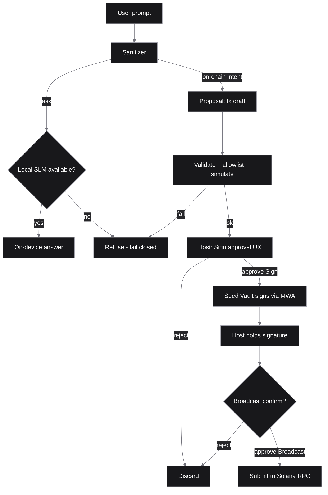

# Architecture

> **Target design** — not shipped. No on-phone SLM, Seed Vault signing, or chain submit path is live yet. See [STATUS.md](STATUS.md). Seed Vault custody rules (design): [DESIGN_SEED_VAULT_BOUNDARIES_V0.md](DESIGN_SEED_VAULT_BOUNDARIES_V0.md) (**SV-0**, not M2).

Salomon Solana is designed with two paths that never share secrets.

1. **Ask path (local, goal):** the prompt would run through an on-device SLM. If no local model is available, the ask fails closed and is refused. There is no silent cloud fallback.
2. **On-chain path (propose-only, goal):** the model would emit a *proposal* (for example a transfer). The proposal is meant to be sanitized, checked against an allowlist, and simulated. Signing would require an explicit user **Sign** confirm via Seed Vault (host → MWA → Vault). **Broadcast would be a second, separate user confirm** after the Vault returns a signature to the host (`sign ≠ broadcast`, Lead lock for M3). The model never holds keys or signatures.

## Components (planned)

- `apps/mobile`: React Native (Expo) shell built on the Solana Mobile Stack (Mobile Wallet Adapter, Seed Vault).
- `crates/core`: shared sanitizer and ask/propose boundary.
- `onchain/`: optional future Anchor program.
