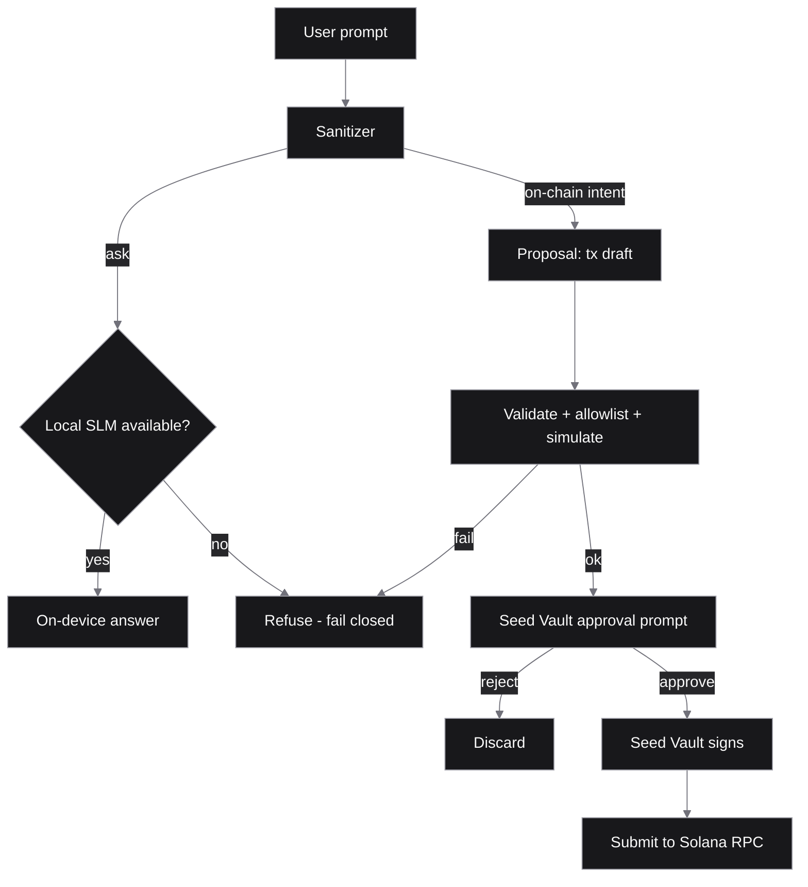

# Architecture

> **Target design** — not shipped. No on-phone SLM, Seed Vault signing, or chain submit path is live yet. See [STATUS.md](STATUS.md).

Salomon Solana is designed with two paths that never share secrets.

1. **Ask path (local, goal):** the prompt would run through an on-device SLM. If no local model is available, the ask fails closed and is refused. There is no silent cloud fallback.
2. **On-chain path (propose-only, goal):** the model would emit a *proposal* (for example a transfer). The proposal is meant to be sanitized, checked against an allowlist, and simulated. Only then would it be shown for explicit approval in Seed Vault. The model never holds keys.

## Components (planned)

- `apps/mobile`: React Native (Expo) shell built on the Solana Mobile Stack (Mobile Wallet Adapter, Seed Vault).
- `crates/core`: shared sanitizer and ask/propose boundary.
- `onchain/`: optional future Anchor program.
